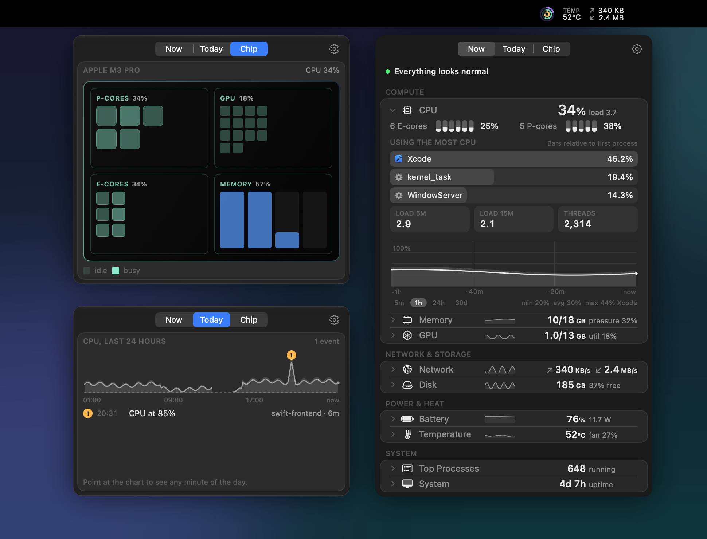
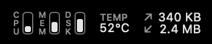
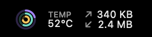
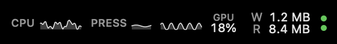
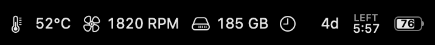
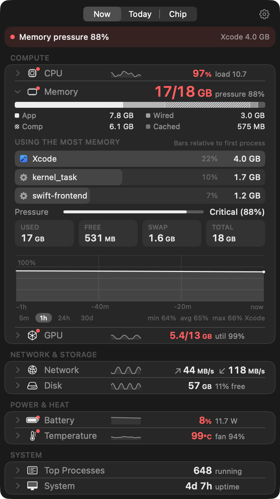
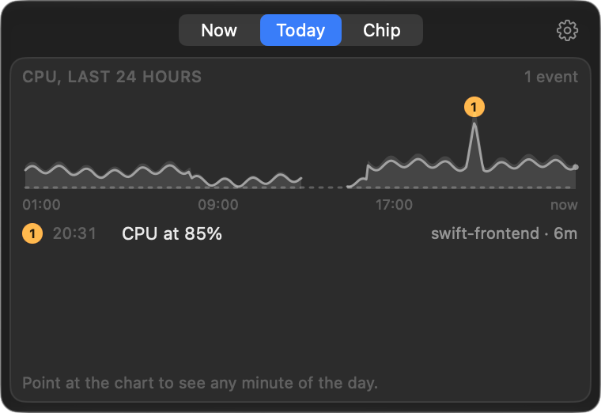
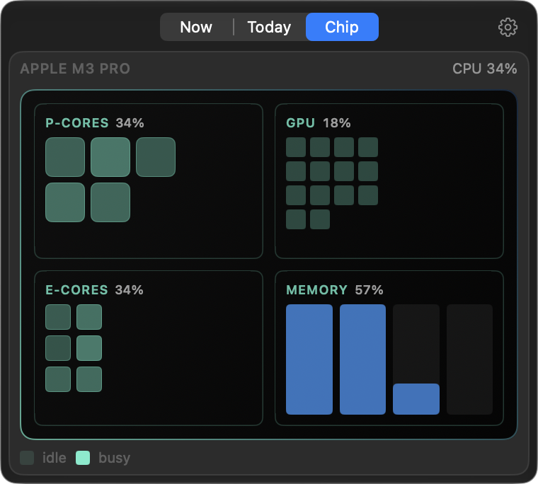
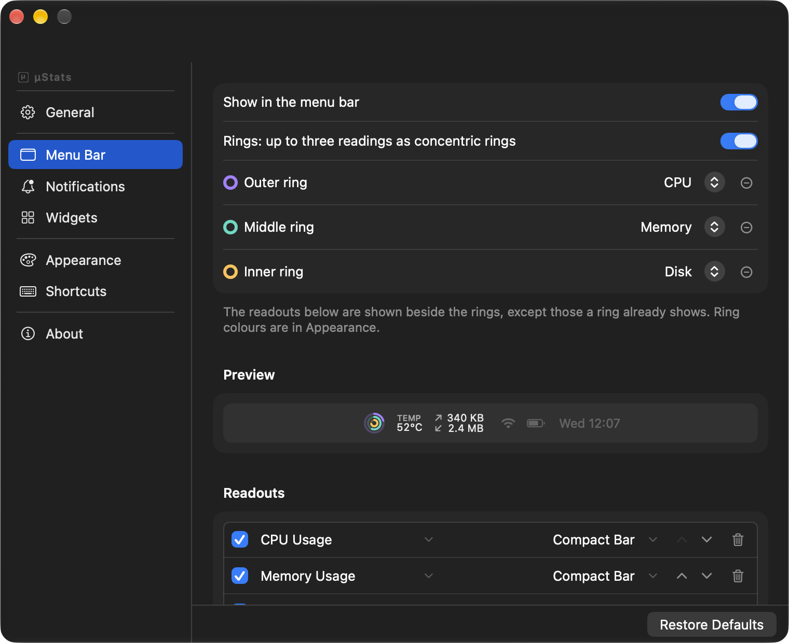
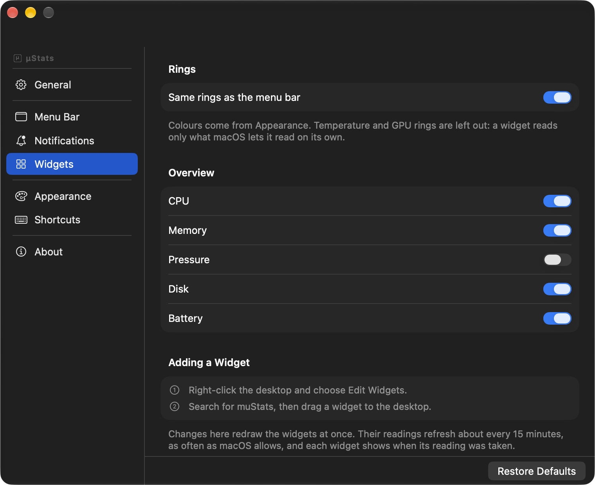

<div align="center">

<picture>
  <source media="(prefers-color-scheme: dark)" srcset="docs/logo-dark.png">
  
</picture>

<h1>μStats</h1>

A lightweight system monitor for the Mac menu bar.

[](#install)
[](#install)
[](#install)
[](LICENSE)




</div>

μStats shows CPU, memory, GPU, network, disk, battery, temperature and processes in the
menu bar. Click it to open a panel with details, history and the processes behind each
number.

## Install

```sh
brew install --cask danesed/tap/mustats
```

Or download [muStats.dmg](https://github.com/Danesed/muStats/releases/latest/download/muStats.dmg),
open it and drag μStats to Applications. The app is signed and notarized.

Requires macOS 14 or later on Apple silicon.

## Features

- **Menu bar:** rings, bars, text, graphs and indicators for 17 metrics, in one item or
  several.
- **Panel:** every module with its details, history charts (5 minutes to 30 days) and
  the processes using the most CPU, memory, disk or energy.
- **Summary line:** when something is high, the top of the panel says what and which
  process, for example "Memory pressure 88%, Xcode 4.0 GB".
- **Today:** CPU over the last 24 hours, with notable moments marked.
- **Chip:** live load on performance cores, efficiency cores, GPU and memory.
- **Alerts:** notifications for CPU, memory pressure, temperature, battery and disk,
  sent only when a condition lasts, with a cooldown.
- **Widgets:** Rings and Overview, in small, medium and large, configured in the app.
- **Command line:** `mustats status`, `mustats top`, JSON output for scripts.
- **Languages:** English and Italian.

## The menu bar

**Default.** CPU, memory and disk as bars, temperature and network as text.



**Rings.** Up to three readings as concentric rings, on their own or next to other
readouts.

&nbsp;&nbsp;&nbsp;


**Ring colours.** Six sets, or pick your own colour for each ring in Appearance.

| Aurora | Ocean | Sunset | Neon | Mono | Fitness |
| :---: | :---: | :---: | :---: | :---: | :---: |
|  |  |  |  |  |  |

**Other styles.** Graph, mini graph, text with graph, stacked pair and status dots:



Icon with text, time left and the battery indicator:



Available metrics: CPU usage, temperature and frequency; memory usage and pressure; GPU;
network up, down or both; disk activity, free space and usage; battery charge, time
left and power draw; fan speed; uptime.

## The panel

<table>
<tr>
<td width="50%" valign="top">

**Under load**



</td>
<td width="50%" valign="top">

**Today**



**Chip**



</td>
</tr>
<tr>
<td valign="top">

**Menu bar settings**



</td>
<td valign="top">

**Widget settings**



</td>
</tr>
</table>

## Command line

The app binary is also a command-line tool. Homebrew links it as `mustats`.

```sh
mustats status                    # every module, one line each
mustats cpu --json                # one module as JSON
mustats top -n 5 --sort energy    # top processes by energy
mustats watch network             # refresh in place, Ctrl-C to stop
```

Without Homebrew:

```sh
ln -s /Applications/muStats.app/Contents/MacOS/muStats /usr/local/bin/mustats
```

## Privacy

Everything is read locally through Mach, IOKit, sysctl and CoreWLAN. There is no account
and no analytics. The app makes these network requests and no others:

| Request | When |
| --- | --- |
| `captive.apple.com` | While the Network details are open, to measure latency. |
| `api.ipify.org` | Only if you turn on "Look up my public IP address". Off by default. |
| GitHub Releases | When you check for updates. |

## Resource use

Measured on an M3 Pro with the panel closed and the default menu bar: 21 MB of memory
(`footprint`) and 0.5% of one core on average over 20 seconds (`top`). It samples only
what is on screen, so the numbers depend on what you show.

## Build from source

Requires Xcode 26 or later, for the macOS 26 SDK.

```sh
git clone https://github.com/Danesed/muStats.git && cd muStats
Scripts/build.sh release
ditto .build/out/Products/Release/muStats.app /Applications/muStats.app
open /Applications/muStats.app
```

See [CONTRIBUTING.md](CONTRIBUTING.md) for tests and code layout, and
[docs/RELEASING.md](docs/RELEASING.md) for signing, updates and the Homebrew tap.

## Support

μStats is free and open source. You can support it through
[GitHub Sponsors](https://github.com/sponsors/Danesed) or [Ko-fi](https://ko-fi.com/danesed).
Bugs and requests go on the [issue tracker](https://github.com/Danesed/muStats/issues).

## Credits

μStats is a fork of [AirStats](https://github.com/byrencheema/airstats) by Byren Cheema.
Updates use [Sparkle](https://sparkle-project.org).

## License

MIT. See [LICENSE](LICENSE), which keeps the original AirStats copyright.
